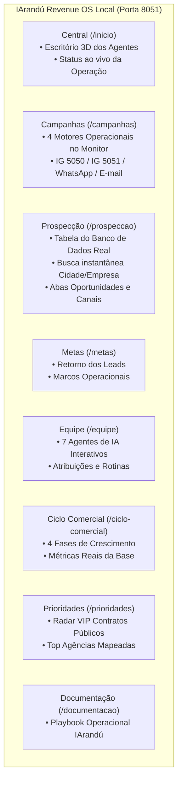

# Plano de Modernização do CRM Operacional Local (Porta 8051)
## Transformação para a Identidade Visual e UX Funcional do IArandú Revenue (`www.iarandu.xyz`)

> [!IMPORTANT]
> **Diretriz Central do Usuário:** O sistema permanecerá rodando localmente na mesma porta (`http://localhost:8051`), mas seu frontend e experiência visual serão uma cópia exata do portal [www.iarandu.xyz](https://www.iarandu.xyz) (repositório [ethosinteligencia-boop/iarandu-revenue](https://github.com/ethosinteligencia-boop/iarandu-revenue)), mantendo **100% da funcionalidade de CRM operacional**, controle de robôs, filtros e bases de dados.

---

## 1. Diagnóstico do Vídeo (`Gravando 2026-10-25 004053.mp4`)

O vídeo de 3 minutos e 34 segundos gravado pelo usuário foi minuciosamente assistido e analisado. Abaixo está o mapeamento exato de cada tela e das decisões apresentadas:

---

## 2. Detalhamento Tela por Tela (Requisitos Específicos do Vídeo)

### A. Central (`/inicio` — Página Inicial 3D)
* **Visual:** Manter o cenário 3D do escritório IArandú com animação e mascotes dos agentes autônomos.
* **Dados Operacionais:** No cabeçalho e widgets, exibir o status da operação ao vivo ("7 agentes ativos", interações consolidadas do dia).
* **Navegação Lateral:** Sidebar com acesso rápido a todas as salas temáticas.

---

### B. Campanhas (`/campanhas` — Painel Operacional no Monitor)
No vídeo, o usuário navega até a tela do monitor (`desk-screen.webp`) e detalha que os 4 cards da jornada de serviço serão substituídos pelos **4 controles operacionais reais**:

| Bloco | Canal / Motor | Elementos e Controles Funcionais |
| :---: | :--- | :--- |
| **01** | **Instagram Pessoal** *(Diego @maldonadodiego55 — Porta 5050)* | • Status ao vivo (`parado` / `enviando` / `anti-bloqueio`) • Botão **Iniciar Robô** • Botão **Pausar Robô** • Botão **Painel 5050** (`http://127.0.0.1:5050`) • Botão **Logar Firefox** (abertura de sessão) |
| **02** | **Instagram Oficial** *(IArandú @iarandu.br — Porta 5051)* | • Status ao vivo (`parado` / `enviando` / `anti-bloqueio`) • Botão **Iniciar Robô** • Botão **Pausar Robô** • Botão **Painel 5051** (`http://127.0.0.1:5051`) • Botão **Logar Firefox** |
| **03** | **WhatsApp Gateway** *(OpenWA IArandú)* | • Status da conexão (`Online / Pronto`) • Disparar lote seguro (8 disparos) • Pausar esteira |
| **04** | **E-mail Corporativo** *(Zoho SMTP)* | • Status da fila de e-mails • Disparar lote de prospecção • Pausar esteira |

---

### C. Prospecção (`/prospeccao` — Quadro Multicanal de Agências)
O usuário demonstrou o quadro branco (`board-room.webp`) e estipulou regras claras de negócio:
* **Tabela de Agências Completa:**
  * Alimentada diretamente pelo nosso banco de dados auditado (`candidatos` / `agencias_sinapro_master` / CSV mestre).
  * Colunas: **Empresa**, **Perfil Decisor**, **Potencial/Contratos**, **Canais Validados (Site, IG, WhatsApp, E-mail)** e **Localidade (UF / Cidade)**.
* **Busca em Tempo Real Funcional:**
  * O usuário testou a busca digitando *"São Paulo"* e *"Curitiba"*. O campo de busca deve filtrar dinamicamente a tabela em memória por nome de agência, município ou estado, com resposta instantânea.
* **Abas do Quadro:**
  * **Mercado & Licitações:** Base completa de agências mapeadas.
  * **Oportunidades:** Contas que responderam ou estão em estágio de proposta/negociação ativa.
  * **Instagram / WhatsApp / E-mails:** Filtro de leads por canal específico.
* **O QUE SERÁ REMOVIDO (Ordem direta do usuário no vídeo):**
  > [!WARNING]
  > **Remoções Determinadas no Vídeo:**
  > 1. **Funil de Vendas tradicional:** O usuário afirmou com clareza: *"Funil de vendas eu não quero mais"*.
  > 2. **Painel de "Hoje para conversar":** Descartar esse componente do layout anterior.

---

### D. Metas (`/metas`)
* Conforme indicado no vídeo: *"Os retornos dos leads a gente pode deixar nas Metas"*.
* Substituir o funil por indicadores objetivos de retorno de leads, taxa de resposta e marcos da operação (Pesquisa, Base regional, Qualificação de contatos e Cadência multicanal).

---

### E. Equipe de Agentes (`/equipe`)
* Manter a visualização interativa com os 7 agentes da IArandú (Orion, Radar, Atlas, Lumi, Nexo, Fluxo e Íris).
* O clique em cada agente abre o drawer lateral detalhando sua função técnica, cadência e tarefas ativas no pipeline.

---

### F. Ciclo Comercial (`/ciclo-comercial`)
* O usuário especificou: *"Vamos organizar qual o tamanho do mapa, quantos sites a gente tem (nada de site demo, mas quantos sites reais temos)..."*.
* Estruturar o ciclo em 4 etapas: **Pesquisar**, **Qualificar**, **Conversar** e **Entregar**.
* Métricas reais da base: Total de Agências Mapeadas, Contratos Somados, Funções Ativas e Gestão Centralizada.

---

### G. Prioridades (`/prioridades`)
* Tabela "Radar VIP": Exibe as contas com maior valor contratual público (agências Top Tier de R$ 100M+ a R$ 1,6 Bi) para abordagem prioritária e personalizada pela liderança.

---

### H. Documentação (`/documentacao`)
* Playbook de inteligência de mercado IArandú documentando o modelo de prospecção, governança de dados, blindagem anti-repetição e segurança da operação.

---

## 3. Arquitetura Técnica da Integração

Para que o sistema continue rodando localmente em `http://localhost:8051`, unificaremos o servidor Python existente com a stack visual do `iarandu-agency-web`:

1. **Servidor HTTP Único (`iarandu_crm_cockpit.py` na porta 8051):**
   * Servirá diretamente os arquivos estáticos de `/mnt/d/iarandu-agency-web/` (HTML, CSS, JS, SVG, WebP, WebM e vídeos dos agentes).
   * Suporte a SPA routing (`/inicio`, `/campanhas`, `/prospeccao`, `/equipe`, `/metas`, `/ciclo-comercial`, `/prioridades`, `/documentacao`).
2. **Camada de APIs REST Reais:**
   * `/api/action/start-instagram` e `/api/action/stop-instagram` (Motor 5050).
   * `/api/action/start-instagram-oficial` e `/api/action/stop-instagram-oficial` (Motor 5051).
   * `/api/action/open-login-firefox` (Perfis do Firefox).
   * `/api/action/start-whatsapp` e `/api/action/stop-whatsapp`.
   * `/api/action/status-all` (Status unificado de todos os motores).
   * `/crm-api/snapshot` e `/crm-api/market` (Alimentação da tabela de prospecção com as 646+ agências do banco).
3. **Persistência e Isolamento:**
   * Continua operando sobre as bases locais existentes (`comercial.db`, `central.db` e `agencias_publicidade.db`) sem alterar os esquemas nem interferir nos bancos que o Agente 4 opera.

---

## 4. Plano de Execução por Etapas

| Etapa | Ação | Entregáveis |
| :---: | :--- | :--- |
| **1** | **Fusão do Servidor na Porta 8051** | Integrar o backend do cockpit para servir a interface moderna do `iarandu-agency-web` com todas as rotas e assets 3D na porta 8051. |
| **2** | **Operacionalização da Tela de Campanhas** | Injetar nos 4 cards do monitor os botões de ação e status real dos robôs (5050 Diego, 5051 Oficial, WhatsApp e E-mail). |
| **3** | **Quadro de Prospecção Dinâmico** | Conectar a tabela do quadro branco à base real de agências e implementar o filtro de busca instantânea (por cidade ou empresa). |
| **4** | **Saneamento de Módulos Obsoletos** | Remover o funil de vendas e o painel de conversas antigas conforme solicitado; integrar métricas em Metas e Prioridades. |
| **5** | **Testes de Acionamento e Validação Ponta a Ponta** | Testar todos os botões na UI (iniciar robô, pausar robô, busca, navegação) e documentar o handoff completo para o Codex-3. |

---

## 5. Próximo Passo
Aguardando sua aprovação deste plano para iniciar a implementação da Etapa 1 e entregar o CRM 100% transformado e funcional!
